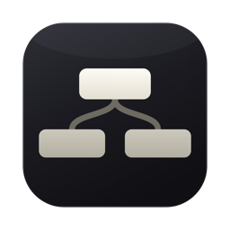
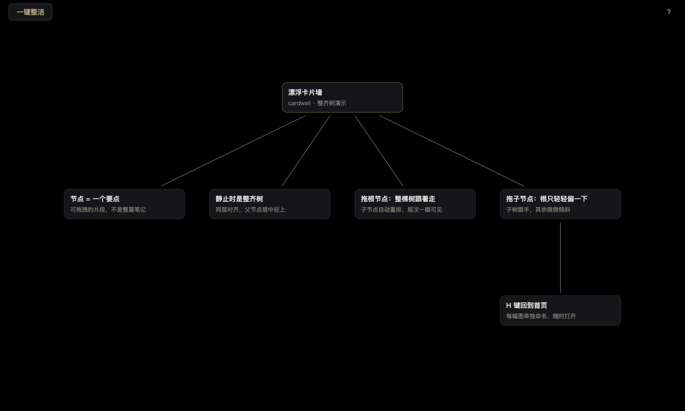
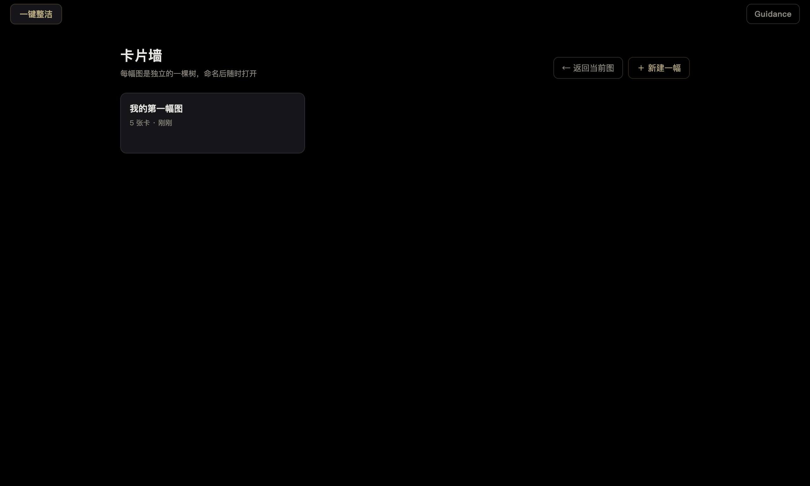
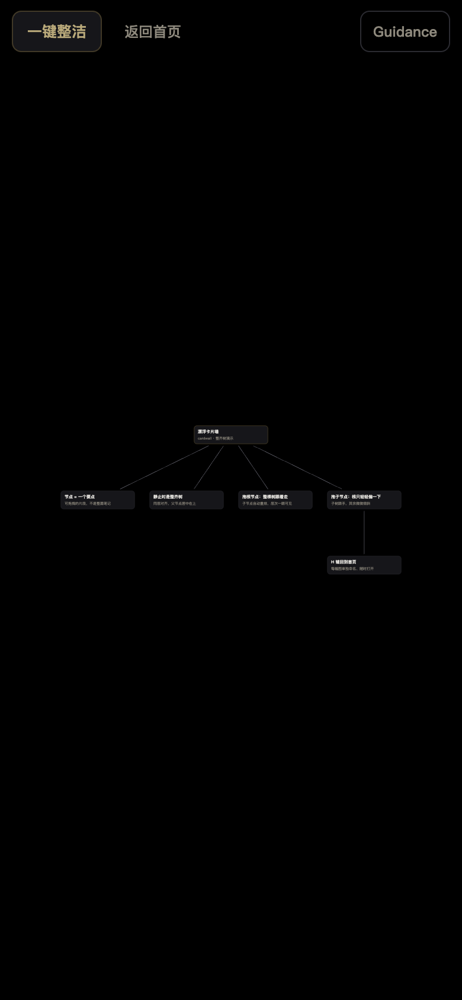
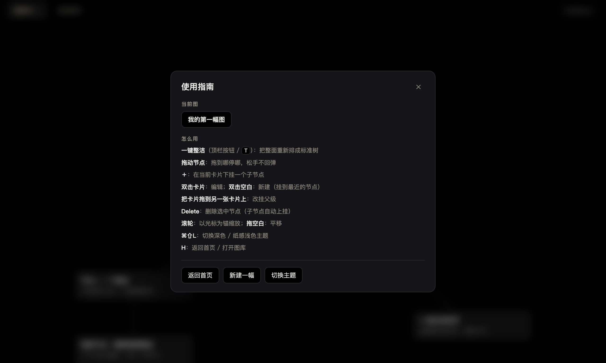

# cardwall（TreeNote）

[中文](README.md) · **English** | [English](README.en.md)



> TreeNote —— 树状笔记的下一种形态：要点能自己排成层次。

力导向**整齐树卡片墙**笔记工具。要点拆成卡片，父子关系自动排成层次分明的树状图：同层对齐、父节点居中在上。每个节点都能随手拖到任意位置、原地停住；想一键回到整齐树，按「一键整洁」即可。

多幅图各自命名，从首页随时打开。



## 首页：多幅图，各自命名

`H`，或点顶栏的 **返回首页**（就在「一键整洁」旁边）。起名即建，随时切换；删除的文件进系统废纸篓，能反悔。**新建一幅图时，画布正中会先放一张空白未命名节点**，直接开始写就行。



## 下载

[GitHub Releases](https://github.com/Franky100-pig/TreeNote/releases/latest) 提供 macOS（arm64）dmg。未做代码签名，首次启动需**右键 → 打开**，或执行 `xattr -dr com.apple.quarantine /Applications/cardwall.app`。

## 网页版 & 手机

**不想装 app？直接用浏览器：<https://franky100-pig.github.io/TreeNote/>**

同一个 app、同一份渲染代码：桌面版走 Electron + 本地文件库，网页版在浏览器里用 localStorage 存图（换设备/清缓存会丢，桌面版才是持久库）。手机上专门做了适配：

- **单指** = 鼠标：拖卡片、拖空白平移、点一下选中并浮出操作条
- **双指捏合** = 缩放（以双指中点为锚）；**双指拖动** = 平移
- 界面不再触发页面滚动/回弹/双击放大；Guidance 在手机上变成**底部抽屉**，库是单列
- 数据只存在这台设备的浏览器里；想跨设备请用桌面版

手机上的效果（Guidance 变成底部抽屉，库为单列）：



## 操作

| 动作 | 手势 |
|---|---|
| **使用指南** | 点顶栏右上角的 **Guidance**：浮出**使用指南**面板——背景**虚化并锁定**，里面有全部手势说明和「返回首页 / 新建一幅 / 切换主题」。`Esc` 或右上角 ✕ 关闭 |
| 回首页 / 打开别的图 | `H`，或点顶栏的**返回首页**（也在 Guidance 里）；点任意卡片打开 |
| 重命名当前图 | 在「使用指南」的「当前图」里点图名（或首页卡片上的「重命名」） |
| 编辑卡片 | 悬停卡片 → 点操作条上的 ✎，**或直接双击卡片**（Escape 取消，Enter 提交） |
| **新建子节点** | 悬停卡片 → 点操作条上的 ＋：在该卡**下方右侧扇出**一张子卡（绝不会盖在父卡上），直接进编辑 |
| 删除卡片 | 悬停卡片 → 点操作条上的 ✕（或选中后按 Delete / Backspace） |
| 新建卡片 | 双击空白处（自动挂到 320px 内最近的卡片，否则为根卡） |
| 改挂父级 | 把卡片拖到另一张卡片上（禁止挂到自己的后代，避免成环） |
| **一键整洁** | 点顶栏「一键整洁」按钮，或按 `T`：把**整面重新排成标准树**。按下有缩放反馈，按钮短暂显示「整理中…」 |
| **自由拖动** | 任意节点拖到哪就停哪——**松手不回弹**，整面进入自由摆放；拖动时它和子节点跟手，其余节点保持原位 |
| 平移 / 缩放 | 拖动空白处 / 滚轮（以光标为锚点，0.2–2.5）；**触屏：双指捏合缩放、双指拖动平移** |
| 调试叠加 | `F3` 或 `Cmd+Shift+D`：fps、卡数、仿真时间、scale、峰值速度、机械能、树目标、速度矢量 |
| 切换主题 | `Cmd/Ctrl+Shift+L`：黑色画布 ⇄ 纸感浅色，偏好会被记住 |

「使用指南」面板浮在画布上方，背景虚化并锁定：



悬停卡片时右上角浮出操作条（✎ / ＋ / ✕），同时该卡被临时**冻住**（不参与物理积分），免得操作条在漂浮中滑走、点不准。编辑时物理世界暂停，提交后恢复。

## 物理：整齐树，不是绳子

每一张卡片都有一个**确定的树状目标位置**（tidy-tree / Reingold–Tilford 风格，叶子打包法）：

- **同层对齐**：同一深度的节点共享一条水平线（父在上、子在下，`levelGap` 间距）
- **父居中于子**：父节点落在它最外侧两个子节点的中点上
- **子树不重叠**：叶子沿一条共享游标从左到右排开，间距 `nodeGap`

但**这根弹簧默认是收着的**：v0.6 起整面默认进入**自由摆放**——每张卡停在你放的位置，互不牵引，松手绝不回弹。只有按下「一键整洁」（或刚打开一幅图）时，弹簧才接通，整面被缓缓吸成标准树。

接通后，每张卡片被一根**临界阻尼弹簧**拉向自己的目标（`k = 40`，临界阻尼系数 `2√k ≈ 12.6`）——约 0.6 秒无过冲地贴上去，**不会像刚性平移那样整枝一起平移**：每张卡按各自的距离独立贴位，整棵树就这样"解"成一张干净的图。

布局是**确定性的**：同样的结构永远排成同样的图，不靠随机。在整齐态下静止时，整面墙就是一张确定的树状图；自由态下静止时各卡原地冻结，互不牵引。

> **自由态也真的会停下来**：弹簧的阻尼项只在整齐态/拖拽时生效，所以曾经有个 bug——松手后别的节点带着残余速度在自由态里匀速滑行、停不下来。现已补上一道**全局粘性衰减**（`CONFIG.globalDamp`，对所有参与积分的卡无条件生效），残余速度会在一秒内衰减归零、卡片休眠，自由态确切「停住」。被弹簧拉着的卡仍用弹簧自身的临界阻尼，手感不变。

### 自由拖动手感

- **拖动任意节点**：松手即停在你放手的位置，整面进入自由摆放——既不回弹成标准树，也不会整块平移。
- **拖动时带着子树**：无论整齐态还是自由态，你抓的那张卡会把它的**整条子树**一起带在手上跟手走；其余节点保持原位，不被牵引。
- **整齐态下拖根**：若当前正处于整齐态（刚打开或刚按过「一键整洁」），拖根会让整棵树以你手里的根为锚重新排布；拖子则子树跟手、其余只朝手方向**轻微倾斜 `childLean = 0.12`**（根约只挪 12%）。一旦松手，整面切回自由态。

**松手后停在哪？** 你拖的那张卡**停在你放手的位置**，其余节点也原地不动——整面变成自由摆放，不再自动重排。想让整面重新成为标准树，按「一键整洁」（按钮或 `T`）即可。

### 关键参数（`renderer/physics.js` 的 `CONFIG`）

| 参数 | 值 | 说明 |
|---|---|---|
| `dt` / `k` / `maxSpeed` | 1/60 s / 40 / 3000 | 固定步长、拉向树目标的弹簧刚度、限速 |
| `nodeGap` / `levelGap` / `rootGap` | 300 / 220 / 360 px | 叶子横向间距 / 层与层纵向间距 / 多棵树之间的间隔 |
| `childLean` | 0.12 | 拖子节点时，其余的树朝手方向倾斜的比例（根只挪约 12%） |
| `repulsion` / `repulsionCutoff` | 22000 / 520 px | 防重叠的软排斥，**只在拖动时生效**（`a = repulsion / d`） |
| `wakeRadius` / `wakeStrength` | 520 / 0.4 | 拖动尾流：手里的卡把邻居按距离推着让开 |
| `driftImpulse` / `driftChance` | 3 px/s / 0.0002 | 静止时极弱的、可复现的布朗"呼吸"（偶发唤醒一张卡轻轻飘一下） |
| `sleepSpeed` / `sleepForce` / `sleepSteps` | 0.6 px/s / 30 px/s² / 60 步 | 休眠判据：够慢、合力够小、连续够久 → 停止积分 |

静止时卡片正好落在树目标上（弹簧归零、没有别的力），所以整面墙是**固定的一张图**，不是一直在抖的一堆卡片；且因为排斥只在拖动时生效，安静的卡片合力低于休眠阈值，会真正睡着。

### 顶栏只剩三个按钮

v0.7 起顶栏做了减法：只留「一键整洁」「返回首页」和右上角的 **Guidance**。原来的图名、提示文字、主题开关都收进**使用指南**面板——点 **Guidance** 时它浮在画布上方、**虚化并锁定背景**，只有 `Esc` / ✕ / 面板内操作才能退出。画布因此更干净，主操作只剩最常用的那一个，回首页也不用再绕进面板。

**每个节点都归树所有**：没有「钉住」这种例外，按「一键整洁」时所有卡片都会参与重排；自由态下各卡停在原地。

### 布局会安定下来

自动布局是确定的，不是随机初值。安静的卡片安静 60 步就**睡着**，停止积分、位置逐位冻结，直到某个力真的超过阈值才被唤醒。所以安顿下来的布局是固定的一堵墙，而不是一直在抖的一堆卡片。漂移只是偶尔叫醒一张卡轻轻飘一下——一次涟漪，不是持续震颤。

## 数据存放

- 默认路径：`~/Library/Application Support/cardwall/vault/boards/<id>.json`（macOS），一幅图一个文件
- 图库**没有索引文件**：目录本身就是索引，每个文件自带 `name`
- 写入是原子的：先写 `.tmp` 再 rename，上一版保留为 `.bak`
- 重命名只改文件里的 `name`（不搬文件、不改 id），正在打开的图不会丢引用
- 删除走系统回收站（`shell.trashItem`），可以撤销
- 0.3 的单文件 `vault/board.json` 自动迁移成「我的第一幅图」，升级不丢墙
- 主进程会 sanitize 读入的 board：丢弃未知字段、截断超长文本、拒绝重复 id 与悬空 / 自引用父级
- 调试可用 `CARDWALL_VAULT_DIR=/tmp/xxx` 覆盖

## 开发

```bash
npm install
npm start          # 正常启动
npm test           # 单测：物理引擎 14 项 + web 存储垫片 9 项
npm run smoke      # 十一层自检：渲染 / 相机 / 调试 / 主题 / 交互 / 编辑 / 操作条 / 使用指南 / 存盘 / 首页 / 读盘
npm run dist       # 打包 macOS dmg → dist/cardwall-<version>-arm64.dmg
npm run build:web  # 生成网页版到 web/（同一份渲染代码 + localStorage 垫片）
```

网页版部署（GitHub Pages，`web/` 即整站，无构建依赖）：

```bash
npm run build:web
git subtree push --prefix web origin gh-pages
```

`npm run smoke` 会开一个隐藏窗口、用合成事件驱动真实监听器，全部通过才退出 0。

国内网络打包建议带镜像（否则 electron zip 直连会超时）：

```bash
ELECTRON_MIRROR="https://npmmirror.com/mirrors/electron/" \
ELECTRON_BUILDER_BINARIES_MIRROR="https://npmmirror.com/mirrors/electron-builder-binaries/" \
npm run dist
```

### 结构

```
main.js                 Electron 主进程：窗口、图库 IPC、vault 原子写、十一层 smoke 断言
preload.js              contextBridge：listBoards / createBoard / openBoard / saveBoard / renameBoard / deleteBoard
renderer/web-bridge.js  网页版存储垫片：localStorage 实现同一套 window.cardwall API（Electron 下自动让位）
scripts/build-web.sh    生成网页版到 web/（复制 index.html / styles.css / renderer，注入 favicon）
index.html styles.css    外壳、主题 token、卡片 / 边 / 调试面板样式
renderer/theme-boot.js  首帧应用已保存的主题（避免浅色闪黑）
renderer/physics.js     整齐树布局 + 临界阻尼弹簧积分器（UMD，Node 单测 + 浏览器共用）
renderer/app.js         世界容器、边几何、固定步长循环、相机、编辑、持久化接线
renderer/interaction.js 平移 / 锚点缩放 / 拖拽 / 改挂
renderer/debug.js       F3 叠加
renderer/sample.js      首次启动的示例树
build/icon.svg          图标源文件；build/icon.icns 由它栅格化生成
test/physics.test.mjs   14 项单测
```

主题全走 `styles.css` 顶部的语义 token（`--bg` / `--surface` / `--ink` / `--edge` …），一套 token 定义就是一种主题：`:root` 是默认深色（纯黑画布），`[data-theme="light"]` 覆盖同一组 token 得到纸感浅色。想加第三套主题，复制一份 token 块 + 在 `applyTheme` 里多认一个名字即可，不用碰任何组件样式。

## 许可

MIT
