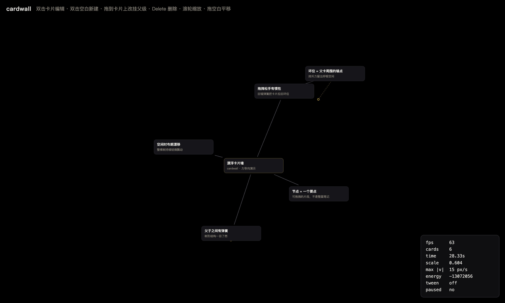
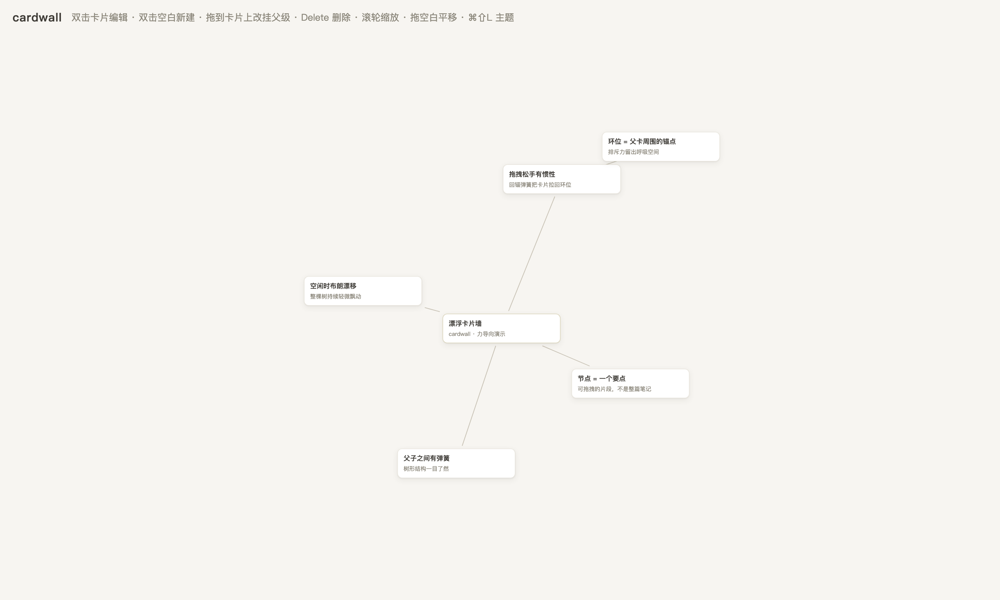

# cardwall（TreeNote）

> The next version of taking digital notes — 但笔记得能飘。

力导向**漂浮卡片墙**笔记工具：要点级卡片 + 自由拖动 + 物理飘动（斥力 / 弹簧 / 阻尼 / 布朗漂移 / 释放惯性）。

Electron 桌面应用，零前端框架：DOM 卡片 + SVG 连线 + CSS transform 世界容器，架构对标 Obsidian Canvas 的逆向结论（证据见仓库外 `obsidian-canvas-re/RE-obsidian-canvas.md`）。与 Obsidian 的关键差异：Canvas 没有物理、没有释放惯性；cardwall 的整棵树靠力场持续轻微呼吸。

默认黑色画布（`Cmd/Ctrl+Shift+L` 可切回纸感浅色，选择会被记住）：


按 `F3` 打开调试叠加（锚点虚线 + 速度矢量 + 实时能量）：



浅色主题（同一棵树，`Cmd/Ctrl+Shift+L` 切换）：



## 开发

```bash
npm install
npm start          # 正常启动
npm test           # 物理引擎单测（9 项）
npm run smoke      # 八层自检：渲染 / 相机 / 调试 / 主题 / 交互 / 编辑 / 存盘 / 读盘 + 截图
npm run dist       # 打包 macOS dmg
```

`npm run smoke` 会开一个隐藏窗口、用合成事件驱动真实监听器，全部通过才退出 0；末尾把落定画面写到 `smoke.png`（打包版写到系统临时目录）。

### 打包

```bash
npm run dist       # → dist/cardwall-0.2.0-arm64.dmg
```

未做代码签名（无 Developer ID）+ 使用 Electron 默认图标，首次打开需在 Finder 里右键 →「打开」。国内网络建议带镜像：

```bash
ELECTRON_MIRROR="https://npmmirror.com/mirrors/electron/" \
ELECTRON_BUILDER_BINARIES_MIRROR="https://npmmirror.com/mirrors/electron-builder-binaries/" \
npm run dist
```

### 环境注意事项（本机实测）

- **二进制下载走国内镜像**（GitHub releases 直连会 fetch failed）：
  `cd node_modules/electron && ELECTRON_MIRROR="https://npmmirror.com/mirrors/electron/" node install.js`
- **WorkBuddy 沙箱预设了 `ELECTRON_RUN_AS_NODE=1`**，会让 Electron 退化成纯 Node
  （症状：`require('electron').app` 为 undefined / 进入 Node REPL）。
  启动时需清除：`env -u ELECTRON_RUN_AS_NODE npm start`
- 沙箱内 Chromium 的 OS 级 sandbox 初始化会被拒，smoke 模式已内置 `--no-sandbox --disable-gpu` 与软件渲染，因此 `npm run smoke` 在受限环境中也能直接跑；正常启动仍用默认沙箱与硬件加速。

## 操作

| 动作 | 手势 |
|---|---|
| 编辑卡片 | 双击卡片（Escape 取消，标题里 Enter 提交） |
| 新建卡片 | 双击空白处（自动挂到 320px 内最近的卡片，否则为根卡） |
| 删除卡片 | 选中后按 Delete / Backspace（子卡改挂到祖父卡） |
| 改挂父级 | 把卡片拖到另一张卡片上（禁止挂到自己的后代，避免成环） |
| 拖动 | 按住卡片拖动，松手有惯性与回弹 |
| 平移 / 缩放 | 拖动空白处 / 滚轮（以光标为锚点，缩放范围 0.2–2.5） |
| 调试叠加 | `F3`（Mac 上可能是 Fn+F3）或 `Cmd+Shift+D`：fps、卡数、仿真时间、scale、峰值速度、机械能、锚点、速度矢量 |
| 切换主题 | `Cmd/Ctrl+Shift+L`：黑色画布 ⇄ 纸感浅色，偏好存 localStorage |

编辑时物理世界会暂停（否则文字在光标下滑动），提交后恢复。

## 主题

所有颜色都从 `styles.css` 顶部的语义 token 取（`--bg` / `--surface` / `--ink` / `--edge` / `--accent-*` …），一套 token 定义就是一种主题：

- `:root` 是默认的深色（纯黑画布 `#000000` + `#16161a` 卡片），也是启动即见的样子
- `[data-theme="light"]` 覆盖同一组 token，还原最初的纸感配色
- 首帧由 `renderer/theme-boot.js` 在 `<head>` 里抢先应用（CSP 禁内联脚本，故独立成文件）；如果等到 `app.js` 再设，浅色主题会先闪一下黑

想加第三套主题（比如高对比 / 护眼），复制一份 token 块 + 在 `applyTheme` 里多认一个名字即可，不需要碰任何组件样式。

## 物理参数（`renderer/physics.js` 的 `CONFIG`）

| 参数 | 值 | 说明 |
|---|---|---|
| `dt` / `damping` / `maxSpeed` | 1/60 s / 0.975 / 3000 | 固定步长、每步阻尼、限速 |
| `repulsion` / `repulsionCutoff` | 150000 / 800px | `a = repulsion / d`，中心距排斥 |
| `springRestLength` / `springStiffness` | 150px / 10 | 父子树边 |
| `snapStiffness` | 6 | 回锚弹簧（弱于树边，树形更清晰） |
| `ringBaseRadius` / `ringSpacing` | 180 / 60 | 根卡环半径、每多一个同层卡片的增量 |
| `driftImpulse` / `driftChance` | 25 px/s / 0.02 | 布朗漂移（seeded，可复现） |

静止距离不是锚点半径：排斥会把静止点外推，单子卡的解析平衡是 `(snap+spring)·(d−rest) = repulsion/d → d≈197px`，单测里用这个解析解做回归。

## 数据存放

- 默认路径：`~/Library/Application Support/cardwall/vault/board.json`（macOS）
- 写入是原子的：先写 `board.json.tmp` 再 rename，上一版保留为 `board.json.bak`
- 首次启动没有存档时展示示例树，改动后自动保存（600ms 防抖）
- 调试/测试可用 `CARDWALL_VAULT_DIR=/tmp/xxx` 覆盖；`npm run smoke` 默认使用一次性临时目录
- 主进程会 sanitize 读入的 board：丢弃未知字段、截断超长文本、拒绝重复 id 与悬空/自引用父级

## 结构

```
main.js                 Electron 主进程：窗口、IPC、vault 原子写、八层 smoke 断言
preload.js              contextBridge：loadBoard / saveBoard
index.html styles.css    外壳、主题 token（深色默认 + 浅色覆盖）、卡片/边/调试面板样式
renderer/theme-boot.js  首帧应用已保存的主题（避免浅色闪黑）
renderer/physics.js     力导向积分器（UMD，Node 单测 + 浏览器共用）
renderer/app.js         世界容器、边几何、固定步长循环、相机、编辑、持久化接线
renderer/interaction.js 平移 / 锚点缩放 / 拖拽 + 释放惯性 / 改挂
renderer/debug.js       F3 叠加
renderer/sample.js      首次启动的示例树
test/physics.test.mjs   9 项单测
```

## 当前进度

- [x] C1 脚手架（Electron 最小窗口）
- [x] C2 物理核心（力导向集成器 + 9 项单测）
- [x] C3 渲染骨架（DOM 卡 + SVG 贝塞尔边 + 固定步长 rAF）
- [x] C4 交互（平移/锚点缩放/拖拽 + 释放惯性 + 相机补间/安定取景）
- [x] C5 卡片编辑（选中/双击编辑/新建/删除/拖拽改挂）
- [x] C6 持久化（JSON vault + IPC + 原子写）
- [x] C7 手感调参 + F3 调试叠加
- [x] C8 dmg 打包（electron-builder，arm64）
- [x] C9 README/截图/tag
- [x] C10 深色主题（纯黑画布 + `Cmd/Ctrl+Shift+L` 切换 + 首帧无闪）

## 许可

MIT
